# 🌸 Sakura OI Web 📱 v0.6.0

<div align="center">
  
</div>

## ¿Qué es Sakura OI Web?

Sakura OI Web (antes SakuraWebApp) es una app para Android que mejora la experiencia de Open WebUI en el teléfono y lo abre dentro de la propia app. Open WebUI sigue funcionando en tu computadora o servidor; Sakura OI Web es la forma de usarlo desde el teléfono. Al pasar a otra app, la versión 0.2.7 mantiene el WebView activo con un servicio de Android y un aviso silencioso mientras Sakura queda en segundo plano. Esto ayuda a conservar la sesión, el lugar donde estabas y la conexión para recibir notificaciones. Si Android cierra la app para liberar memoria, Sakura vuelve a cargar la última dirección guardada al abrirla. Si no puede conectarse al servidor, muestra un aviso de que no hay conexión y ofrece volver a intentar. La primera vez, un asistente pide la dirección del servidor (en casa y, si quieres, fuera de casa), prueba la conexión y solicita los permisos.

## ¿Qué problema resuelve?

Si abres Open WebUI en Chrome y cambias a otra app, el teléfono puede cerrar esa pestaña para ahorrar memoria. Al regresar, Chrome puede cargar la página otra vez y hacerte perder el punto exacto donde estabas trabajando o tener que volver a buscar la conversación. Esto no borra el chat guardado en el servidor, pero interrumpe la continuidad de la actividad. Además, para que el micrófono, la selección de archivos y el teclado funcionen bien dentro de una app, Android necesita que esas funciones estén conectadas correctamente con la página.

Sakura OI Web adapta Open WebUI para usarlo desde una app instalada en Android. Lo abre en una ventana interna y conecta con funciones del teléfono como el teclado, el micrófono, el audio y el selector de archivos e imágenes. Al iniciar abre Open WebUI directamente, sin pantalla de carga propia. Si no logra conectar con el servidor, enseña un mensaje con un botón para volver a intentarlo.

## Objetivo general

Compartir un ejemplo completo y una guía clara para que otras personas puedan conectar su propia instalación de Open WebUI y crear una app Android para usarla en sus teléfonos. Cada persona puede adaptar la dirección de su servidor, sus certificados y las funciones de voz que prefiera.

## ✨ Qué incluye

- Open WebUI se abre dentro de la app Android, que permite volver atrás y conserva la sesión mientras Android la mantenga activa.
- Asistente de configuración inicial con prueba de conexión y paso de permisos; las direcciones se cambian después en **Ajustes del teléfono**.
- Dirección de casa y dirección exterior: en tu Wi-Fi usa la local, fuera la exterior, y cambia sola manteniendo la sesión.
- Compartir con Sakura desde cualquier app, “Preguntar a Sakura” al seleccionar texto, accesos directos del icono y Sakura como asistente del teléfono.
- Aviso “Sin conexión” mientras no hay red y deslizar hacia abajo para recargar.
- “Oye, Sakura” opcional para abrir el modo de voz con la app en segundo plano.
- Apertura directa de Open WebUI y pantalla de error de conexión, con opción para reintentar, solo cuando de verdad no hay conexión.
- Los archivos de Open WebUI que no cambian se guardan en el teléfono para no descargarlos en cada arranque.
- Los enlaces a otros sitios se abren en el navegador predeterminado del teléfono (por ejemplo, Chrome); las páginas de tu Open WebUI siguen dentro de la app.
- El botón de descarga de Open WebUI guarda imágenes y archivos en **Descargas/Sakura OI Web**, cada uno con un nombre único (fecha y cuatro caracteres al azar, por ejemplo `20261108Bn21.png`).
- Tema oscuro completo: las barras de arriba y de abajo toman el color de Open WebUI, y las pantallas propias de la app siguen el modo oscuro del teléfono.
- Al tocar **Subir Archivos**, se abre el selector del sistema Android para elegir uno o varios archivos o imágenes.
- Compatibilidad con el teclado de Android: la pantalla se reajusta para mantener visible el cuadro de mensaje y sus controles.
- Permisos de micrófono y audio gestionados por Android y WebView.
- Notificaciones de Android cuando Sakura termina de responder, incluso con **Notificación Sonora** desactivada en Open WebUI. Los avisos aparecen sin sonido ni vibración en el canal Android **Mensajes de Sakura (sin sonido)**; el ajuste de sonido de Open WebUI controla el audio, no estos avisos. Android muestra el logo multicolor como icono grande; el icono pequeño de la barra de estado es monocromo por diseño del sistema. Al salir de la app, un servicio en primer plano muestra un aviso silencioso persistente “Sakura sigue conectada” para ayudar a mantener el WebView y su conexión mientras usas otra app; se detiene al volver. Android aún puede cerrar procesos si necesita memoria, así que no garantiza avisos si la conexión se pierde. Activa el permiso en Android y **Ajustes → Interfaz → Notificaciones** en Open WebUI. Detalles en [Implementación Android](docs/ANDROID.md#notificaciones-de-android).
- Icono y logo de Sakura OI Web; el arte original está en [assets/sakura-oi-web-original.png](assets/sakura-oi-web-original.png).
- **TTS opcional:** Qwen3-TTS Fast es el proveedor usado en esta instalación de ejemplo. No es requisito; puedes configurar otro proveedor de texto a voz compatible con tu instancia de Open WebUI, o no usar TTS.
- **Uso fuera de casa:** guía para conectarte desde datos móviles aunque no tengas IP pública (CGNAT), con Tailscale Funnel. Ver [docs/TAILSCALE.md](docs/TAILSCALE.md).
- **Logo y favicon de Open WebUI:** script [server/aplicar_icono.py](server/aplicar_icono.py) que cambia el icono de la pestaña, la barra lateral y la app instalada a partir de una sola imagen. Ver [docs/ICONO-OPENWEBUI.md](docs/ICONO-OPENWEBUI.md).

## 🖼️ Capturas

Las capturas muestran la animación de inicio mientras conecta, la pantalla de error si el servidor no responde, Open WebUI en tema claro y oscuro, el inicio de sesión, la pantalla principal, el modo de voz, los ajustes de Open WebUI y el icono instalado en Android. La captura de notificación de respuesta de la versión 0.2.6 conserva el icono anterior; en 0.2.7 Android muestra el logo multicolor como icono grande.

<details>
<summary>Ver capturas de Sakura OI Web</summary>

| Sin conexión |
|:--:|
| 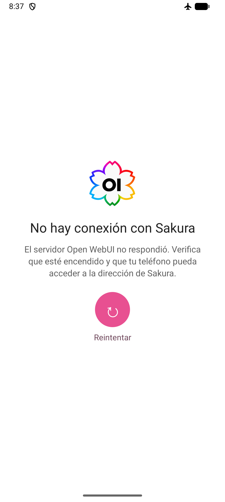 |

| Tema claro y tema oscuro |
|:--:|
| 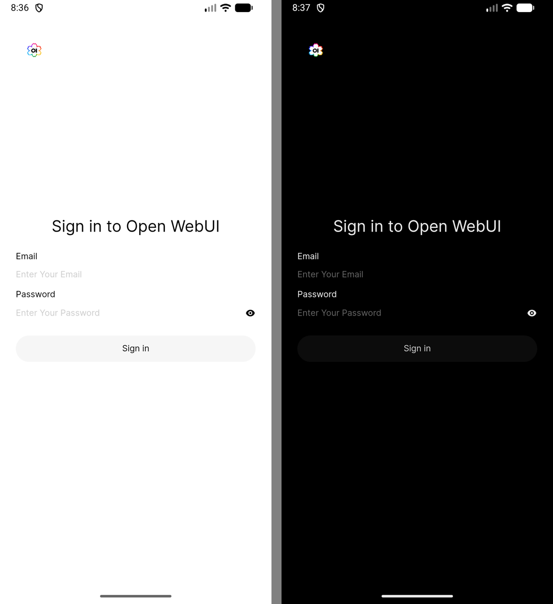 |

| Iniciar sesión | Pantalla principal |
|:--:|:--:|
|  |  |

| Modo de voz | Ajustes de interfaz |
|:--:|:--:|
|  |  |

| Notificación de respuesta (captura 0.2.6) | Icono en el lanzador |
|:--:|:--:|
| 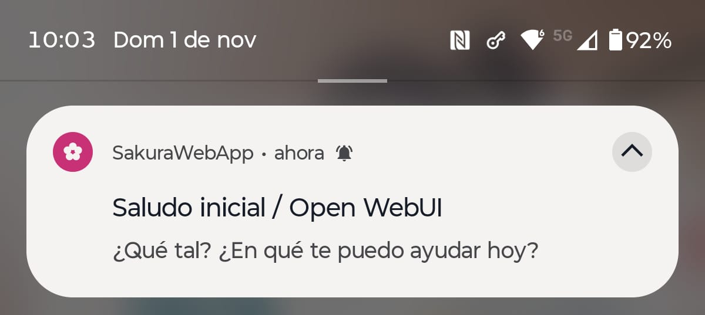 | 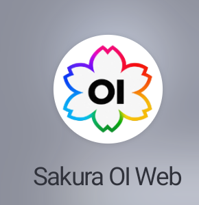 |

</details>

## 📦 Versiones documentadas

- App: Sakura OI Web **0.6.0** (versionCode 39). Historial completo en [CHANGELOG.md](CHANGELOG.md).
- Notificaciones verificadas en el teléfono Android 16 de referencia con Open WebUI 0.12.3. Pantallas, icono y barras en tema claro y oscuro de 0.2.1 a 0.2.3 verificados en el emulador de Android Studio (API 37).
- Open WebUI: **0.12.3**, versión verificada en la instalación local.
- Nombre visible del modelo en Open WebUI: **Sakura**. Los registros identifican **llama.cpp 0.7.0-dev**, compilado para x64 con CUDA desde el commit `ea0c4c2c8`, que carga `SoAIHQ/Qwen3.5-9B-GGUF:Q4_K_M` (Qwen 3.5 de 9B, cuantización Q4_K_M). llama.cpp es el servidor de inferencia; el modelo no pertenece a la familia Llama. El alias Sakura se configura en Open WebUI.
- Voz de ejemplo (opcional): Qwen3-TTS Fast compatible con API de OpenAI, modelo **qwen3-tts-clone-0.6b**, puerto local **5052**. Puedes usar otro TTS compatible o no configurar voz.
- Android de referencia: Android 16 (API 36). La app declara minSdk 23 (Android 6.0), targetSdk 36 (Android 16) y compileSdk 37 (Android 17/API 37). compileSdk es la plataforma usada al compilar; no significa que el teléfono necesite Android 17.
- Herramientas fijadas en el proyecto: Android Gradle Plugin 9.4.1, Gradle 9.6.0, Kotlin 2.2.10 y JDK 17 para ejecutar Gradle. El código Java usa compatibilidad de lenguaje 11.
- Ideas en desarrollo y pendientes, incluida la activación por voz “Oye, Sakura”, en [docs/IDEAS.md](docs/IDEAS.md).

## 🆕 Novedades de la versión 0.6.0

La versión más grande hasta ahora: la app se configura sola desde el teléfono y se integra con Android.

**Configuración desde la app**
- **Asistente de configuración inicial:** si la app no tiene dirección, al abrirla aparece una bienvenida para escribir la dirección **En casa** (IP local y puerto) y la de **Fuera de casa** (opcional), probar la conexión y empezar. Cada dirección muestra *Probando…*, *Conectado* o el motivo del fallo (*No responde*, *Certificado no válido*, …), y **Guardar e iniciar** se activa cuando al menos una responde. Ya no hace falta compilar con la URL.
- **Paso de permisos:** después de la conexión, una pantalla con Notificaciones, Micrófono y Asistente del teléfono (opcional), cada uno con su botón y la marca *Concedido*.
- **Ajustes del teléfono:** pantalla propia de la app con la conexión, los permisos, el asistente y “Oye, Sakura”. Se abre desde el menú de tu usuario en Open WebUI (opción **Ajustes del teléfono**, encima de Settings), desde el acceso directo del icono, desde la información de la app en Android y desde la pantalla de error de conexión.
- La app está en español y en inglés, y sigue el idioma del teléfono.

**Integración con Android**
- **Compartir con Sakura:** comparte texto, enlaces, fotos o PDF desde cualquier app y se abre un chat nuevo con el texto escrito y los archivos adjuntos, sin enviarse.
- **Preguntar a Sakura:** aparece en el menú al seleccionar texto en cualquier app.
- **Accesos directos del icono:** Chat nuevo, Modo de voz, Último chat y Ajustes.
- **Asistente del teléfono:** Sakura se puede elegir como asistente digital de Android; el gesto o botón de asistente abre directamente el modo de voz.

**Conexión**
- **Red de casa y exterior:** en el Wi-Fi de casa usa la dirección local si responde, que es más rápida, y fuera de casa la exterior. Cambia sola al pasar de una red a otra y conserva la sesión, sin volver a iniciar sesión.
- **Aviso sin conexión:** una barra “Sin conexión. Reconectando…” aparece mientras el teléfono no tiene red, y la página se recarga sola al volver si había fallado.
- **Deslizar para recargar:** deslizar hacia abajo con el chat arriba del todo recarga la página.

**Voz**
- **“Oye, Sakura” (opcional, desactivado por defecto):** con la app en segundo plano, decir la frase abre el modo de voz. El reconocimiento funciona en el teléfono con un modelo en español de unos 39 MB que se descarga al activarlo; se pausa mientras usas la app. Mantiene el micrófono escuchando y consume batería.
- El APK pasa de unos 12 MB a unos 38 MB por la librería de reconocimiento de voz.

| Asistente inicial | Probando la conexión | Permisos |
|:--:|:--:|:--:|
| 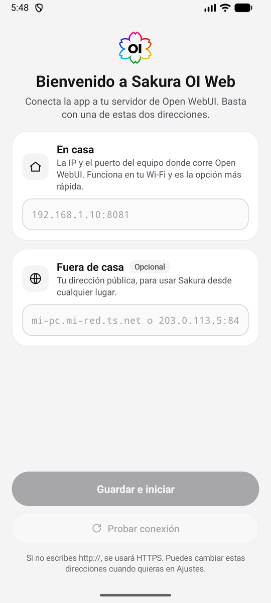 | 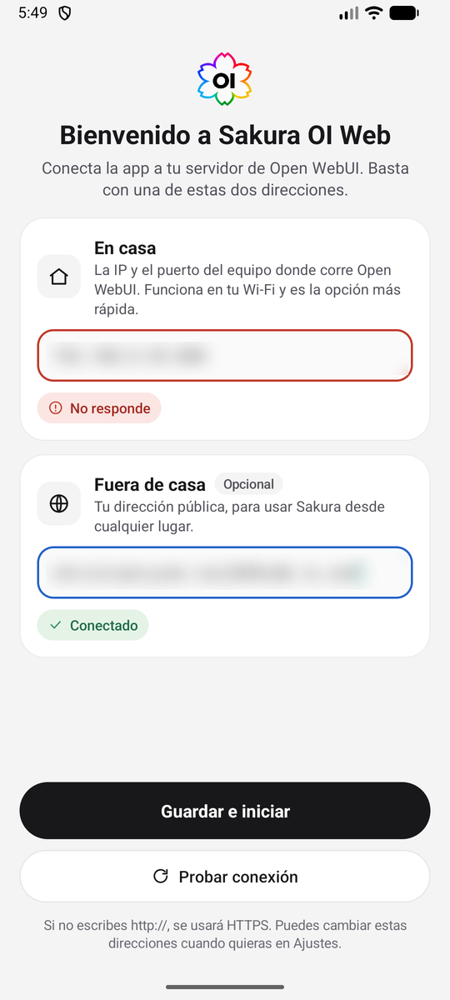 | 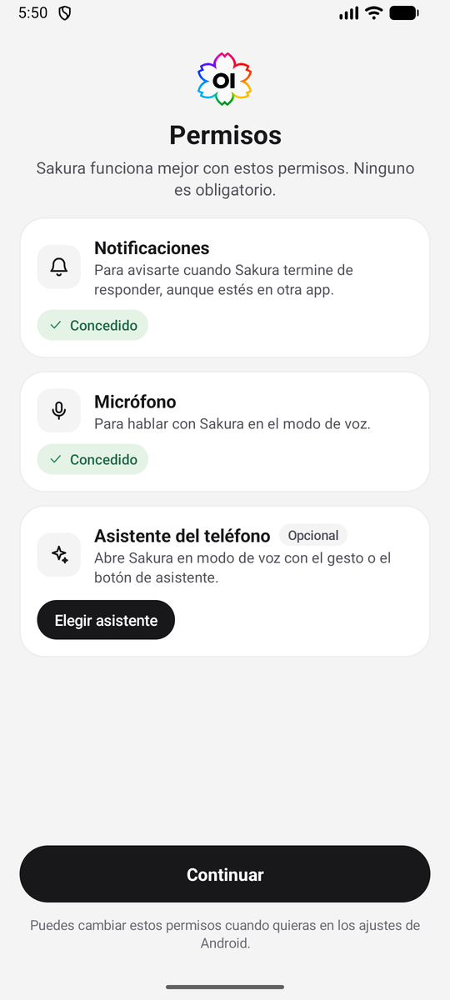 |

| Menú de usuario | Ajustes del teléfono | Elegir asistente |
|:--:|:--:|:--:|
| 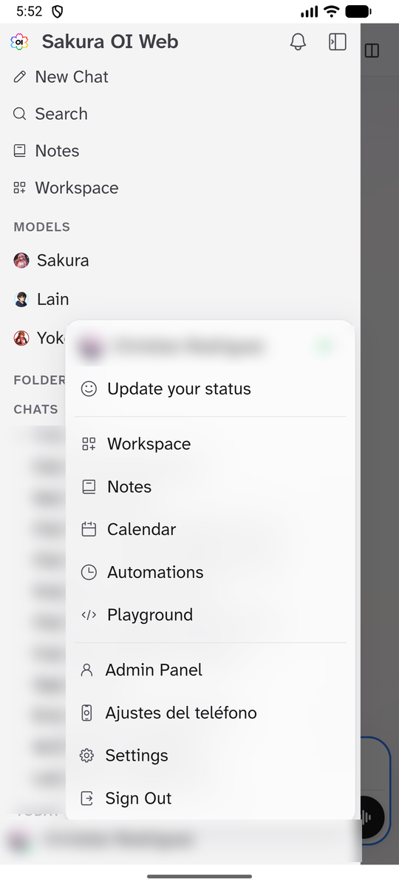 | 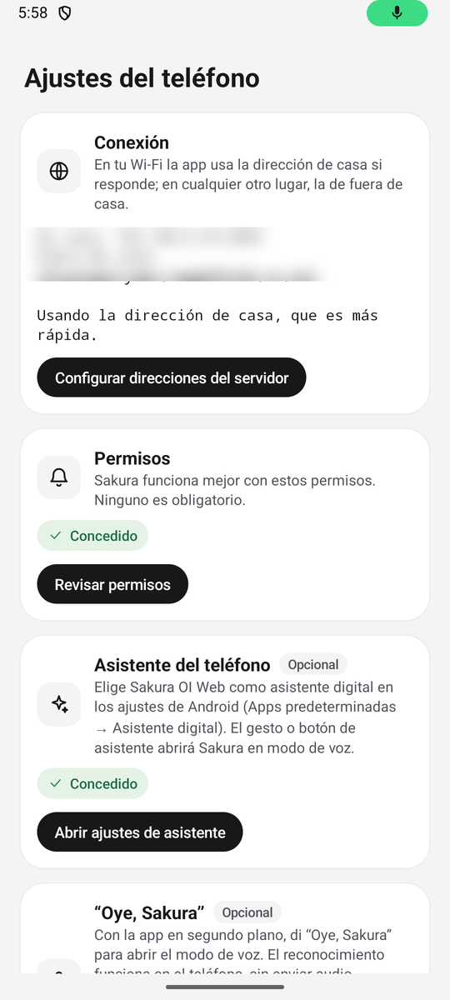 | 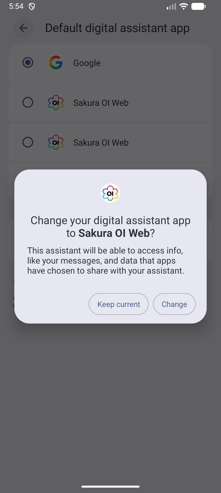 |

| Compartir una imagen | Deslizar para recargar | Sin conexión |
|:--:|:--:|:--:|
| 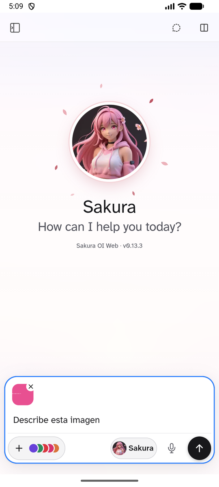 | 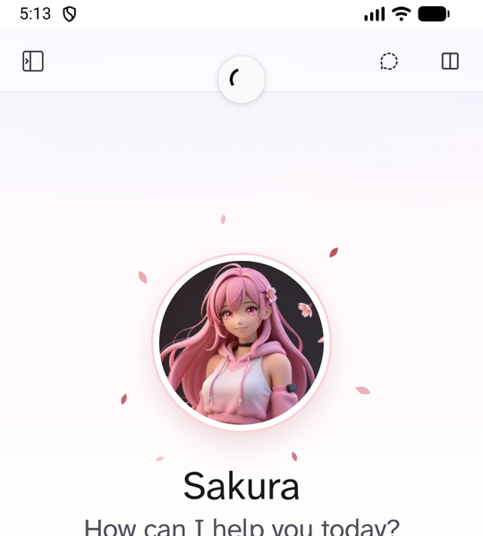 | 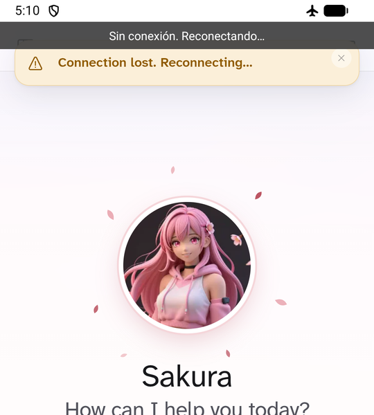 |

### Versión 0.3.2

- **Apertura directa:** se quitó la pantalla de carga propia de la app (logo, versión y espera mínima de 3 segundos). Open WebUI se muestra desde el primer momento.
- **"Sin conexión" solo cuando de verdad no hay conexión:** antes aparecía si la página tardaba más de 5 segundos, aunque el servidor respondiera. Ahora solo sale ante un error real: sin internet, servidor inalcanzable, error de certificado o el servidor responde con un error 5xx. Al tocar **Reintentar**, la flecha gira hasta que la página carga o vuelve a fallar.
- **Menos descarga en cada arranque:** los archivos de Open WebUI en `/_app/immutable/` llevan su versión en el nombre y nunca cambian, pero el servidor los envía sin caché ni compresión. La app los guarda en el teléfono la primera vez: en las pruebas, cada arranque pasó de descargar 812 KB a 52 KB, lo que se nota sobre todo con datos móviles.
- **Consejo para el servidor:** gran parte de la espera al abrir es Open WebUI armando la lista de modelos, porque consulta en cada carga todas las conexiones configuradas. Activar **Panel de administración → Ajustes → Conexiones → Cachear lista de modelos** bajó esa petición de 2.6 s a 0.24 s y el arranque completo de unos 10 s a unos 7.5 s. A cambio, los modelos nuevos de un servidor no aparecen hasta reiniciar Open WebUI o volver a guardar las conexiones.
- Incluye los cambios de la compilación local 0.3.1, que no se publicó por separado.

### Versión 0.3.0

- **El botón de descarga del visor de imágenes ya responde al toque.** El visor usa una librería de zoom con los dedos que cancela el inicio de cada toque, así que en el teléfono el botón nunca recibía el clic (con el mouse en la PC sí funcionaba). Ahora, si un toque corto sobre un botón del visor se cancela de esa forma, la app hace el clic. El zoom con los dedos sigue funcionando.
- **Cada descarga tiene un nombre único.** Open WebUI llama a todas las imágenes `generated_image.png`, así que se repetía el nombre y no se guardaban más. Ahora cada descarga se guarda como fecha (año, mes, día) más cuatro letras o números al azar, por ejemplo `20261108Bn21.png`, en Descargas/Sakura OI Web.
- Incluye los cambios de las compilaciones locales 0.2.10 y 0.2.11, que no se publicaron por separado.

### Versión 0.2.9

- **Descargas que funcionan:** el botón de descarga del visor de imágenes no hacía nada en la app, porque Open WebUI guarda los archivos con enlaces `blob:` que el WebView de Android ignora. Ahora la app los intercepta y guarda la imagen o el archivo en **Descargas/Sakura OI Web**, con un aviso al terminar. Aparece en la galería y en la app de Archivos.
- Las descargas normales del servidor se envían al gestor de descargas de Android con la sesión de Open WebUI, y muestran una notificación al completarse.
- En Android 10 o posterior no hace falta ningún permiso. En Android 9 o anterior, la app pide el permiso de almacenamiento la primera vez.

### Versión 0.2.8

- **Enlaces externos en el navegador:** al tocar un enlace que lleva a otro sitio (por ejemplo, una fuente citada en una respuesta), se abre en el navegador predeterminado del teléfono, como Chrome, en lugar de reemplazar Open WebUI dentro de la app. Al volver, Sakura sigue en la misma página.
- Las páginas de tu propio servidor de Open WebUI se siguen abriendo dentro de la app, y las redirecciones del servidor (por ejemplo, durante un inicio de sesión) no se interrumpen.
- Los enlaces `mailto:` y `tel:` abren la app de correo o de teléfono. Si ninguna app puede abrir un enlace, Sakura muestra un aviso.

### Versión 0.2.7

- **Avisos sin sonido:** las notificaciones de respuesta se publican en un canal nativo de Android silencioso y visible, separado del sonido de Open WebUI. Se usa un canal nuevo para respetar que Android conserva la configuración de canales anteriores.
- **Logo actualizado en las notificaciones:** el icono grande muestra el logo multicolor de Sakura OI Web. El icono pequeño de estado conserva el formato monocromo que Android exige.

### Versión 0.2.6

- **Conexión en segundo plano:** al salir de la app después de cargar Open WebUI, Sakura inicia un servicio en primer plano con un aviso silencioso persistente. Android le da mayor prioridad al proceso, lo que ayuda a conservar el WebView y la conexión mientras usas otra app. Al volver a Sakura, el servicio se detiene. Android aún puede terminar la app si necesita memoria.
- **Notificaciones de respuestas:** ya no se borran todas al regresar a Sakura; los avisos quedan en el panel hasta que los abras o descartes.

### Versión 0.2.5

- **Continuidad de navegación:** guarda la última dirección de Open WebUI y la restaura tras recrear la actividad o reiniciar el proceso, mostrando la animación de carga mientras vuelve a conectar.

### Versión 0.2.4

- **Tema de las barras del sistema:** se toma el color declarado por Open WebUI y su tema (sistema, claro, oscuro, OLED o Her), sin inferirlo a partir de tonos oscuros de diálogos o imágenes.

### Versión 0.2.3

- **Botón Reintentar en negro:** en la pantalla “No hay conexión con Sakura”, el botón redondo es negro con la flecha blanca y el texto **Reintentar** es negro, igual que la pantalla de carga. En modo oscuro se invierten: botón blanco, flecha negra y texto blanco.
- **Repositorio renombrado a Sakura-OI-Web:** las rutas de ejemplo de las guías usan la carpeta `Sakura-OI-Web` y el proyecto de Android Studio se llama igual. Los enlaces antiguos a `SakuraWebApp` redirigen al nuevo nombre.
- **Captura de la pantalla de error** actualizada.

### Versión 0.2.2

- **Indicador de carga y texto en negro:** el círculo que gira y el texto “Conectándose con el servidor…” de la pantalla de carga ahora son negros, en lugar del arcoíris y el rosa de 0.2.1. Con el teléfono en modo oscuro se muestran en blanco para que se vean sobre el fondo oscuro.
- **Captura de la pantalla de carga** actualizada.

### Versión 0.2.1

- **Nuevo nombre: Sakura OI Web.** Así aparece la app debajo del icono, en los ajustes de Android y en el aviso de permisos. El identificador interno (`com.sakura.webapp`) no cambia, por lo que el APK se instala encima de la versión anterior sin perder la sesión.
- **Nueva identidad visual:** icono del lanzador, pantalla de carga y pantalla de error usan el logo de la flor con contorno arcoíris y las letras **OI**.
- **Pantalla de carga renovada:** muestra el logo, el nombre y la versión, un indicador giratorio con los colores del logo y el texto “Conectándose con el servidor…”.
- **Tema oscuro corregido:** la barra de arriba (hora y notificaciones) y la de abajo (la línea de gestos de Android) se quedaban blancas al cambiar Open WebUI al tema oscuro. Ahora toman el color de fondo de la página y cambian al momento cuando cambias de tema. Las pantallas de carga y de error, y la ventana de inicio, siguen el modo oscuro del teléfono.
- **Direcciones sin puerto:** la app reconoce como propia una URL como `https://<tu-pc>.<tu-tailnet>.ts.net/` (puerto 443 implícito), necesaria para el micrófono, las notificaciones y el color de las barras al usar Tailscale.
- **Documentación:** nombre e identidad actualizados, capturas nuevas de carga, error, tema oscuro e icono, y sección "Barras del sistema y tema oscuro" en [docs/ANDROID.md](docs/ANDROID.md#barras-del-sistema-y-tema-oscuro).

## 🗺️ Ideas y hoja de ruta

Las próximas funciones están en [docs/IDEAS.md](docs/IDEAS.md): compartir con Sakura desde cualquier app, "Preguntar a Sakura" al seleccionar texto, accesos directos del icono, Sakura como asistente del teléfono, cambio automático entre la red de casa y la exterior, aviso de conexión perdida, deslizar para recargar, avisos aunque Android cierre la app, bloqueo con huella, APK firmado con aviso de actualización y la activación por voz "Oye, Sakura".

## 💡 Guías del servidor

Cambios solo de documentación y del servidor, publicados entre las versiones 0.1.10 y 0.2.1 de la app.

- **Usar Sakura desde la calle con Tailscale:** si tu proveedor usa CGNAT y no puedes abrir puertos, publica Open WebUI con Tailscale Funnel, agrega esa dirección a `CORS_ALLOW_ORIGIN` (si no, la página carga pero las respuestas no llegan) y compila la app con `https://<tu-pc>.<tu-tailnet>.ts.net/`. Guía completa en [docs/TAILSCALE.md](docs/TAILSCALE.md).
- **Cambiar el logo y el favicon de Open WebUI:** [server/aplicar_icono.py](server/aplicar_icono.py) genera todos los iconos desde una imagen, los aplica sin reiniciar y puede restaurar los originales con `--restaurar`. Desde cualquier carpeta:

  ```powershell
  & 'C:\ruta\a\Open WebUI\Scripts\python.exe' 'C:\ruta\a\Sakura-OI-Web\server\aplicar_icono.py' --logo 'C:\ruta\a\mi-logo.png'
  ```

  Detalles, licencia y cómo quitar el icono viejo de la caché en [docs/ICONO-OPENWEBUI.md](docs/ICONO-OPENWEBUI.md).

## 🗂️ Novedades de versiones anteriores

### 0.1.10

- **Notificaciones de Android:** cuando Sakura termina de responder y la app está en segundo plano, o estás en otro chat, aparece una notificación con el título del chat y el inicio de la respuesta. En 0.1.10 los avisos se borraban al volver; desde 0.2.6 permanecen hasta abrirlos o descartarlos.
- **Permiso de notificaciones al abrir la app:** la primera vez que carga Open WebUI, la app pide el permiso de Android. Antes solo se pedía desde el interruptor de Open WebUI, y si ese ajuste ya estaba activado desde otro navegador, Android bloqueaba los avisos.
- **La URL del servidor se toma de `SAKURA_WEBUI_URL`:** la app abría siempre el host de ejemplo aunque se compilara con otra dirección. Ahora la página inicial, la comprobación de carga y el permiso del micrófono usan la URL indicada al compilar.
- **Diagnóstico:** si un aviso no se muestra, Logcat registra el motivo con la etiqueta `SakuraWebApp`.
- **Documentación:** nueva sección de notificaciones en [docs/ANDROID.md](docs/ANDROID.md#notificaciones-de-android), captura de la notificación y cómo guardar la URL en `%USERPROFILE%\.gradle\gradle.properties`.

## 📜 Historial de versiones

Resumen de todos los cambios de la app. El detalle de cada versión está en [CHANGELOG.md](CHANGELOG.md).

| Versión | versionCode | Cambios |
|---|---:|---|
| **0.6.0** | 39 | Asistente de configuración y de permisos, Ajustes del teléfono, compartir con Sakura, “Preguntar a Sakura”, accesos directos, asistente del teléfono, red de casa y exterior, aviso sin conexión, deslizar para recargar, “Oye, Sakura” e idioma inglés. |
| 0.3.2 | 38 | Apertura directa sin pantalla de carga, aviso de sin conexión solo ante errores reales y caché permanente de los archivos de Open WebUI que no cambian. |
| 0.3.1 | 37 | Compilación local sin pantalla de carga; incluida en 0.3.2. |
| 0.3.0 | 36 | El botón de descarga del visor responde al toque y cada descarga se guarda con un nombre único (fecha + 4 caracteres al azar). |
| 0.2.11 | 35 | Compilación local con los nombres únicos de descarga; incluida en 0.3.0. |
| 0.2.10 | 34 | Compilación local que repite el toque en los botones del visor de imágenes; incluida en 0.3.0. |
| 0.2.9 | 33 | El botón de descarga guarda imágenes y archivos en Descargas/Sakura OI Web. |
| 0.2.8 | 32 | Los enlaces a otros sitios se abren en el navegador predeterminado del teléfono; las páginas de Open WebUI siguen dentro de la app. |
| 0.2.7 | 31 | Notificaciones nativas silenciosas independientes del sonido de Open WebUI y logo multicolor en el icono ampliado. |
| 0.2.6 | 30 | Servicio en primer plano mientras la app está fuera de pantalla; ayuda a conservar la conexión y las notificaciones de respuesta al regresar. |
| 0.2.5 | 29 | Guarda y restaura la última dirección de Open WebUI al recrear el proceso. |
| 0.2.4 | 28 | Las barras de Android siguen el color de tema declarado por Open WebUI, sin confundir diálogos/imágenes oscuras con el tema oscuro. |
| 0.2.3 | 27 | Botón y texto **Reintentar** en negro (invertidos en modo oscuro); repositorio y proyecto renombrados a Sakura-OI-Web. |
| 0.2.2 | 26 | Indicador de carga y texto “Conectándose con el servidor…” en negro (blanco en modo oscuro). |
| 0.2.1 | 25 | Nombre Sakura OI Web, nueva identidad (icono, logo y pantallas), indicador de carga con los colores del logo, texto “Conectándose con el servidor…”, barras del sistema que siguen el tema oscuro y reconocimiento de URLs sin puerto (Tailscale). |
| 0.2.0 | 24 | Compilación local con el nombre Sakura OI Web; no se publicó por separado y sus cambios están en 0.2.1. |
| 0.1.12 | 23 | Compilación local con la flor de Sakura en la pantalla de error; incluida en 0.2.1. |
| 0.1.11 | 22 | Compilación local que acepta direcciones HTTPS sin puerto, como las de Tailscale; incluida en 0.2.1. |
| 0.1.10 | 21 | La app pide el permiso de notificaciones al cargar Open WebUI por primera vez; registro en Logcat cuando se descarta un aviso. |
| 0.1.9 | 20 | Compilación que incluye las notificaciones de Android; mismo código que 0.1.8. |
| 0.1.8 | 19 | Notificaciones de Android para los avisos de Open WebUI y corrección de la URL de `SAKURA_WEBUI_URL`. |
| 0.1.7 | 18 | Primera versión documentada: Open WebUI en un WebView, pantallas de carga y de error, selector de archivos, micrófono, ajuste al teclado e icono de Sakura. |

## 🚀 Pasos para usar o adaptar el proyecto

1. Prepara una instancia de Open WebUI y confirma que el teléfono pueda abrirla en la red.
2. Configura HTTPS y un certificado confiable para el host que usarás. La guía explica cómo trabajar con una CA local.
3. Clona este repositorio y compila la app. La dirección del servidor ya no es obligatoria al compilar: la app la pide la primera vez.
4. Instala el APK en Android, escribe la dirección en el asistente, prueba la conexión y concede los permisos de notificaciones y micrófono si usarás voz.
5. Configura el TTS que prefieras dentro de Open WebUI si quieres respuestas habladas. No necesitas instalar el servidor Qwen de este ejemplo.

Las guías detallan la instalación del servidor, las variables, los certificados, la URL que hay que cambiar, los permisos y los problemas de carga de archivos:

- [Configuración de Open WebUI y TTS](docs/OPENWEBUI.md)
- [HTTPS y certificados](docs/HTTPS.md)
- [Implementación Android, ícono, permisos, archivos y capturas](docs/ANDROID.md)
- [Consejo: usar Sakura fuera de casa con Tailscale (CGNAT, sin IP pública)](docs/TAILSCALE.md)
- [Cambiar el logo y el favicon de Open WebUI](docs/ICONO-OPENWEBUI.md)

## 🛠️ Compilar

### Requisitos y versiones de Android

Instala Android Studio compatible con Android Gradle Plugin 9.4.1, Android SDK Platform API 37.0 y JDK 17. El proyecto usa Gradle 9.6.0 mediante el wrapper incluido, así que no necesitas instalar Gradle por separado. No hace falta instalar todas las plataformas que aparecen en SDK Manager. La configuración del proyecto solicita `compileSdk { version = release(37) }`; API 37.0 es la plataforma base requerida. La entrada API 37.1 que aparece en tu SDK Manager es una extensión opcional y no está fijada por el proyecto. En Android Studio puedes revisar el JDK en **Settings → Build, Execution, Deployment → Build Tools → Gradle → Gradle JDK**.

| Ajuste | Valor | Qué significa |
|---|---|---|
| Android mínimo | API 23 / Android 6.0 | Versión mínima para instalar la app |
| Android objetivo | API 36 / Android 16 | Comportamientos de Android para los que está configurada |
| SDK de compilación | API 37 / Android 17 | Plataforma necesaria para compilar; no es requisito para el teléfono |
| Versión de Sakura OI Web | 0.6.0 (versionCode 39) | Versión del APK de este repositorio |

La versión de Android de tu teléfono es independiente del SDK de compilación. En el dispositivo Android 16 de referencia, la app funciona con target API 36.

### Comando exacto para compilar

Desde Android Studio abre la carpeta raíz del proyecto. En la terminal integrada de Android Studio, desde esa carpeta, ejecuta:

```powershell
.\gradlew.bat assembleDebug
```

Sin más parámetros, la app abre su asistente de configuración la primera vez y guarda las direcciones en el teléfono. Si prefieres que ya vengan escritas, pásalas al compilar (todas son opcionales):

```powershell
.\gradlew.bat assembleDebug -PSAKURA_WEBUI_URL="https://<dirección-exterior>/" -PSAKURA_WEBUI_LAN_URL="https://<IP-local>:8081/"
```

- `SAKURA_WEBUI_URL`: dirección exterior, por ejemplo la de Tailscale.
- `SAKURA_WEBUI_LAN_URL`: dirección de la red de casa (IP local y puerto).
- `SAKURA_VERSION_SUFFIX`: letra añadida a la versión de una compilación personal (por ejemplo `c` → 0.6.0c).
- `SAKURA_APPLICATION_ID_SUFFIX`: sufijo del identificador para instalar una versión de prueba junto a la normal (por ejemplo `.prueba`).

El host es el equipo que ejecuta Open WebUI, no el teléfono. Usa una dirección que el teléfono pueda alcanzar por Wi-Fi o VPN. Una IP privada de la red local no es accesible por datos móviles sin una ruta o VPN configurada.

> 💡 **Consejo:** si no tienes IP pública (CGNAT) y quieres usar Sakura desde la calle, publica Open WebUI con Tailscale Funnel y compila la app con la dirección `https://<tu-pc>.<tu-tailnet>.ts.net/`. Los pasos, el ajuste de CORS y las precauciones de seguridad están en [docs/TAILSCALE.md](docs/TAILSCALE.md).

Si Android SDK Platform API 37.0 no está instalado, abre **Tools → SDK Manager → SDK Platforms** e instala Android 17 / API 37.0. No necesitas marcar todas las versiones ni instalar API 37.1 para este proyecto. Después vuelve a ejecutar el comando. El APK de depuración queda en `app/build/outputs/apk/debug/app-debug.apk` (si Gradle aplica `archivesBaseName`, el nombre puede variar). En Android Studio también puedes usar **Build → Build Bundle(s) / APK(s) → Build APK(s)**; al terminar, pulsa el enlace **locate** del aviso para abrir la carpeta.

Instala una actualización encima de la app existente para conservar los datos locales; desinstalarla puede borrar la sesión del WebView. La compilación debug no es un APK firmado para Google Play.

## 🔐 Privacidad

Este repositorio contiene el código Android, capturas de la app y documentación. No contiene el APK generado, perfiles o bases de datos de Open WebUI, claves secretas, certificados TLS privados ni la CA local de una instalación. No subas `local.properties`, `data/`, bases de datos, `.webui_secret_key`, archivos `.key`, directorios TLS, APKs o certificados privados. La CA pública de una instalación local se agrega solo al build local cuando haga falta; ver [HTTPS.md](docs/HTTPS.md).
