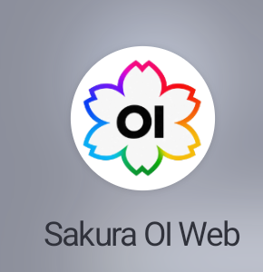
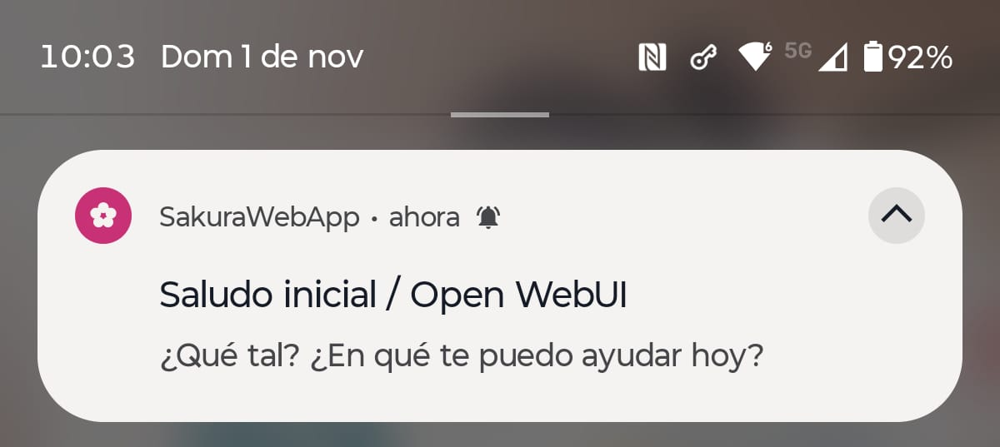
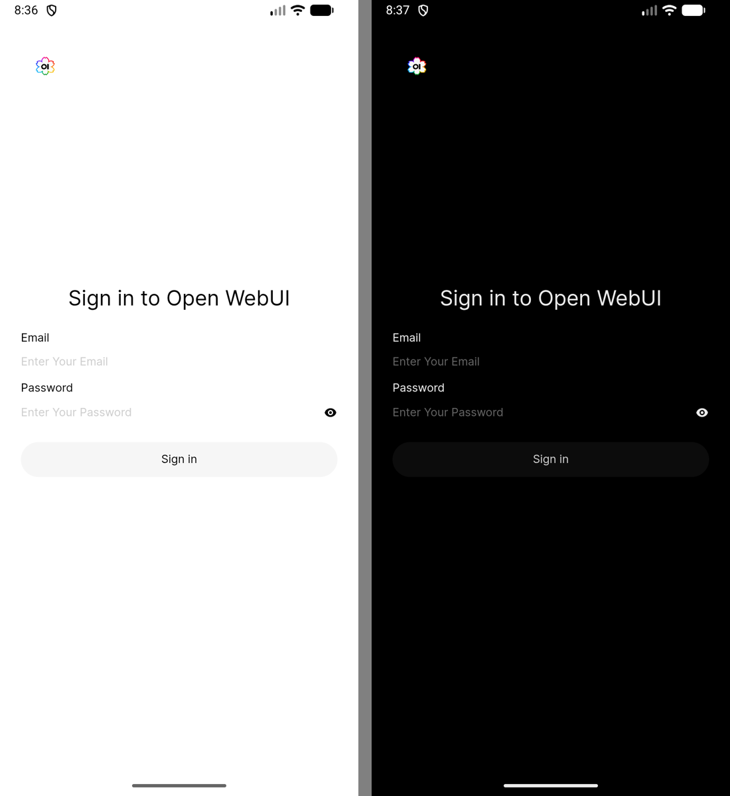
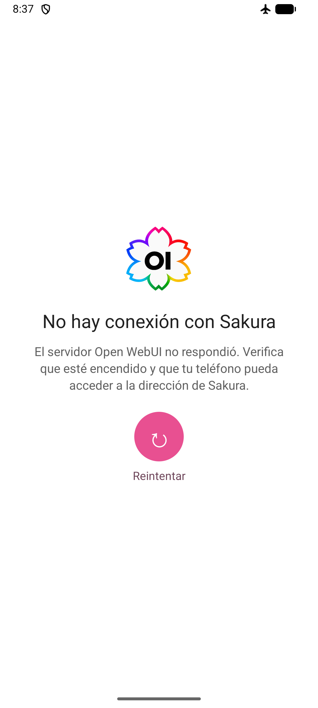

# Implementación Android

## Objetivo: Open WebUI como una app Android

El objetivo general de Sakura OI Web (antes SakuraWebApp) es ofrecer Open WebUI como una aplicación Android completa y cómoda de usar, manteniendo la página dentro de un WebView propio en vez de abrirla como una pestaña de Chrome. Así, mientras Android mantenga vivo el proceso de la app, al volver a la app se conserva la página ya abierta y no se depende del ciclo de vida de una pestaña del navegador. Chrome puede descartar pestañas en segundo plano para liberar memoria y recargarlas al regresar.

La app habilita cookies y DOM storage, guarda/restaura el estado de navegación cuando Android recrea la actividad y recuerda la última dirección de Open WebUI. Desde la versión 0.2.6, al pasar a otra app inicia un servicio en primer plano con una notificación silenciosa; esto aumenta la prioridad del proceso para ayudar a conservar el WebView y la conexión. No reserva memoria ni garantiza que Android mantenga la página cargada: el sistema aún puede cerrar procesos si necesita recursos. Si eso ocurre, Sakura OI Web vuelve a mostrar su pantalla de carga y abre la última dirección guardada; la sesión y los datos del servidor son independientes de que la página siga cargada.

Sakura OI Web es la capa Android y Open WebUI sigue siendo el servidor que contiene la interfaz, cuenta, chats y configuración. La app no copia ni sustituye el perfil del servidor. Al iniciar una actividad nueva, abre directamente la última página de Open WebUI. Si la conexión falla de verdad, muestra un mensaje de error y ofrece reintentar.

## Compilar la app Android

Esta tabla distingue la versión de Android que puede instalar la app del SDK usado para compilarla:

| Configuración | Valor del proyecto | Significado |
|---|---:|---|
| Android mínimo (minSdk) | API 23 / Android 6.0 | Versión mínima admitida por el APK |
| Android objetivo (targetSdk) | API 36 / Android 16 | Comportamientos del sistema para los que se configura |
| SDK de compilación (compileSdk) | API 37 / Android 17 | SDK que debe instalarse para compilar; el teléfono no requiere Android 17 |
| Sakura OI Web | 0.8.0 (versionCode 50) | Versión actual del proyecto |
| Android Gradle Plugin | 9.4.1 | Plugin de compilación Android |
| Gradle Wrapper | 9.6.0 | Versión incluida y usada por el proyecto |
| Kotlin | 2.2.10 | Versión configurada del plugin de Kotlin |
| JDK para ejecutar Gradle | 17 | JVM usada por Android Studio/Gradle |
| Compatibilidad del código Java | 11 | Nivel de lenguaje configurado |

Instala Android Studio compatible con **Android Gradle Plugin 9.4.1**, JDK 17 y **Android SDK Platform API 37.0** desde **Tools → SDK Manager → SDK Platforms**. El proyecto declara `compileSdk { version = release(37) }`, que usa la plataforma base API 37.0. No hace falta instalar todas las plataformas de la lista: la entrada API 37.1 que aparece en tu captura es opcional y el proyecto no la fija. No necesitas instalar Gradle por separado; el wrapper usa Gradle 9.6.0. El teléfono Android 16 de referencia corresponde a API 36 y la app también tiene `targetSdk = 36`; Android SDK 37 se necesita en la computadora para compilar, no en el teléfono.

Abre en Android Studio la carpeta raíz del proyecto. En la pestaña **Terminal**, desde esa carpeta, ejecuta:

```powershell
.\gradlew.bat assembleDebug -PSAKURA_WEBUI_URL="https://<IP-o-host-del-PC>:8081/"
```

Reemplaza el marcador por la dirección HTTPS que el teléfono pueda alcanzar y quita los signos `< >`. No publiques una IP privada. La sección siguiente explica qué valores de host deben coincidir.

El APK se genera en `app/build/outputs/apk/debug/` (normalmente `app-debug.apk`). Si Android SDK Platform API 37.0 no aparece instalado, Gradle informará el error; instálalo en SDK Manager y ejecuta de nuevo el comando. API 37.1 y las plataformas API 36, 35 o anteriores no son requisitos de compilación para esta configuración. Si el servidor usa una CA local, sigue primero la guía [HTTPS y certificados](HTTPS.md) y agrega su certificado público al build local.

Desde la versión 0.6.0 la URL es opcional: si compilas sin ella (también con **Build → Build APK(s)**), la app abre su asistente de configuración la primera vez y guarda las direcciones en el teléfono. Las propiedades solo sirven para que vengan ya escritas.

Para no escribir la URL en cada compilación, guárdala en el archivo de propiedades de Gradle de tu usuario, `%USERPROFILE%\.gradle\gradle.properties` en Windows. Está fuera del repositorio, así que tu dirección no acaba en Git, y Android Studio la usa también con **Build → Build APK(s)** y el botón **Run**:

```properties
SAKURA_WEBUI_URL=https://<IP-o-host-del-PC>:8081/
# Opcionales:
SAKURA_WEBUI_LAN_URL=https://<IP-local>:8081/
SAKURA_VERSION_SUFFIX=c
```

Referencias oficiales: [compatibilidad de Android Gradle Plugin](https://developer.android.com/build/releases/about-agp), [JDK para builds Android](https://developer.android.com/build/jdks), [Android 16 / API 36](https://developer.android.com/tools/releases/platforms#android_16), [Android 17 / API 37](https://developer.android.com/about/versions/17/release-notes).

## Qué host/IP se configura

Se configura la dirección del equipo Windows donde corre Open WebUI, en HTTPS y puerto 8081; no la dirección del teléfono ni `127.0.0.1`. En la versión local se usaba una IP privada de LAN. El repositorio público la reemplaza por `https://open-webui.example:8081/` para no publicar la dirección doméstica.

Pasa tu host al compilar:

```powershell
.\gradlew.bat assembleDebug -PSAKURA_WEBUI_URL="https://<IP-o-host-del-PC>:8081/"
```

Gradle la incorpora en `BuildConfig.WEBUI_URL`; `MainActivity.kt` la usa para abrir Open WebUI y comprobar el origen del permiso del micrófono. Mantén esa dirección igual en `WEBUI_URL`, `CORS_ALLOW_ORIGIN`, el certificado TLS y el teléfono. Si cambias la dirección del PC, actualiza todos esos valores y vuelve a compilar.

## Ícono y logo de Sakura OI Web

Desde la versión 0.2.1 la app usa la identidad Sakura OI Web: una flor de cinco pétalos con el contorno en arcoíris y las letras **OI** en el centro. El arte original está en `assets/sakura-oi-web-original.png` y la versión recortada y cuadrada en `assets/sakura-oi-web-icon.png`. A partir de esa imagen se generaron:

- `app/src/main/res/drawable-nodpi/sakura_foreground.png`: primer plano del icono adaptable (Android 8 o posterior), con el logo dentro de la zona segura sobre fondo blanco.
- `app/src/main/res/mipmap-*/ic_launcher.webp` e `ic_launcher_round.webp`: iconos para versiones anteriores a Android 8, sobre un cuadrado redondeado y un círculo blancos.
- `app/src/main/res/drawable-nodpi/sakura_logo.png`: el logo que aparece en las pantallas de carga y de error de conexión.

El manifiesto selecciona `@mipmap/ic_launcher` y `@mipmap/ic_launcher_round`. La identidad anterior (la flor rosa) se conserva en `assets/sakura-original.png` y `assets/sakura-icon.png`.

<div align="center">
  
</div>

Para cambiarla desde Android Studio:

1. Clic derecho en `app/src/main/res` → **New → Image Asset**.
2. En **Icon Type**, selecciona **Launcher Icons (Adaptive and Legacy)**.
3. Elige tu PNG como imagen de primer plano y ajusta el recorte/tamaño.
4. Elige un color de fondo, revisa la vista previa y pulsa **Next → Finish**.
5. Revisa que el manifiesto siga apuntando a los recursos `ic_launcher`.

Para una imagen que se muestra en una pantalla, agrega el archivo a `app/src/main/res/drawable-nodpi/` (por ejemplo, `sakura_banner.png`) y cárgalo con `R.drawable.sakura_banner`. Mantén nombres de recursos en minúsculas, números y guion bajo. No uses la carpeta `mipmap` para imágenes normales.

## Micrófono: permiso Android y permiso WebView

Hay dos autorizaciones independientes: Android debe conceder `RECORD_AUDIO` a Sakura OI Web y el WebView debe aprobar la solicitud de origen web.

- `AndroidManifest.xml` declara `INTERNET`, `RECORD_AUDIO`, `MODIFY_AUDIO_SETTINGS` y `POST_NOTIFICATIONS`. Para mantener Open WebUI activa al cambiar de app, también declara `FOREGROUND_SERVICE` y `FOREGROUND_SERVICE_SPECIAL_USE`, usados por `SakuraKeepAliveService` y su [aviso de conexión en segundo plano](#notificaciones-de-android).
- La app solicita `RECORD_AUDIO` en tiempo de ejecución mediante Activity Result API.
- `WebChromeClient.onPermissionRequest` valida que el origen coincide con el host HTTPS configurado y concede solo `RESOURCE_AUDIO_CAPTURE`. Las demás solicitudes se rechazan.
- `onPermissionRequestCanceled` limpia una solicitud pendiente.
- `mediaPlaybackRequiresUserGesture = false` permite que el audio generado por Open WebUI se reproduzca sin una segunda pulsación.
- Los errores TLS se cancelan; la app no acepta certificados inválidos a ciegas.

Concede también el permiso en Android: **Ajustes → Aplicaciones → Sakura OI Web → Permisos → Micrófono**. HTTPS con un certificado confiable es necesario para que el contenido web pueda acceder a dispositivos multimedia en WebView. Las reglas de origen seguro se describen en la [documentación de WebChromeClient](https://developer.android.com/reference/android/webkit/WebChromeClient).

## Selector de archivos e imágenes múltiples

Al tocar “Subir Archivos” en Open WebUI, la app abre el selector de documentos del sistema Android. No depende de un explorador incrustado en la página: la app conecta el WebView con el selector nativo mediante `WebChromeClient.onShowFileChooser`.

La app lanza `ACTION_OPEN_DOCUMENT` con `CATEGORY_OPENABLE`, tipo `*/*` y `EXTRA_ALLOW_MULTIPLE=true`. Al volver, procesa `ClipData` para varios elementos y `Intent.data` para un solo elemento, y entrega todos los URI al callback de la página. Android otorga acceso a los elementos que el usuario eligió, por lo que no se concede permiso general de almacenamiento. La elección del sistema admite seleccionar varias imágenes/archivos en una operación. Es el flujo recomendado de [ACTION_OPEN_DOCUMENT](https://developer.android.com/reference/android/content/Intent#ACTION_OPEN_DOCUMENT).

Para que la página pueda cerrar una vista previa de imagen a pantalla completa, el botón Atrás envía Escape a los diálogos web antes de navegar hacia atrás o cerrar la app.

## Notificaciones de Android

Cuando Sakura termina de responder y la app está en segundo plano, o estás en otro chat, aparece una notificación de Android con el título del chat y el inicio de la respuesta.

La captura siguiente es de la versión 0.2.6 y conserva el icono anterior. Desde 0.2.7, Android muestra el logo multicolor de Sakura OI Web como icono grande de la notificación.



Cómo funciona:

- Open WebUI ya avisa con la API de notificaciones del navegador (`new Notification(...)`), pero el WebView de Android no la implementa. `WebNotificationBridge.kt` inyecta un sustituto de `window.Notification` en la página que reenvía cada aviso a la app mediante una interfaz JavaScript, y la app lo publica en el canal **Mensajes de Sakura (sin sonido)**. El icono grande muestra `sakura_logo.png`; el icono pequeño de la barra de estado es monocromo por diseño de Android.
- El puente solo responde mientras el WebView muestra el origen HTTPS configurado en `SAKURA_WEBUI_URL`.
- Open WebUI guarda el ajuste de notificaciones en el servidor, por usuario. Si ya lo activaste en otro navegador, la página nunca pide permiso en el teléfono, así que la app solicita `POST_NOTIFICATIONS` por su cuenta la primera vez que carga Open WebUI (Android 13 o posterior).
- Al volver a Sakura, el servicio de conexión en segundo plano se detiene. Los avisos de respuesta no se borran automáticamente; puedes abrirlos o descartarlos desde Android.
- **El sonido es independiente:** el ajuste **Notificación Sonora** de Open WebUI controla la reproducción de audio de la página. No debe desactivar los avisos nativos de Android. El canal **Mensajes de Sakura (sin sonido)** es silencioso y visible; el interruptor **Notificaciones del Navegador** de Open WebUI debe permanecer activado.
- Desde 0.2.7, el canal de respuesta es nuevo porque Android fija el sonido al crear cada canal. Si tenías un canal anterior, los avisos nuevos usan **Mensajes de Sakura (sin sonido)** en Ajustes de Android → Aplicaciones → Sakura OI Web → Notificaciones.
- `SakuraKeepAliveService.kt` mantiene el proceso de la app en primer plano mientras el WebView queda detrás de otra app. Android exige una notificación visible para este servicio; el canal **Conexión en segundo plano** es silencioso y de prioridad baja.
- Tocar una notificación abre la app donde la dejaste. Open WebUI no indica en el aviso a qué chat corresponde, así que no se abre ese chat directamente.

Para activarlas:

1. Acepta el permiso de notificaciones cuando Android lo pida. Si lo rechazaste, actívalo en **Ajustes → Aplicaciones → Sakura OI Web → Notificaciones**.
2. En Open WebUI, activa **Ajustes → Interfaz → Notificaciones del Navegador**. **Notificación Sonora** es opcional y no afecta a los avisos de Android.

El servicio se inicia mientras la actividad aún está visible y se detiene al volver, conforme a las restricciones de Android para iniciar servicios en primer plano desde el fondo. Reduce la probabilidad de que el sistema mate el proceso y desconecte el WebView, pero no lo impide ni reserva RAM; cerrar la app desde recientes o aplicar restricciones agresivas de batería también puede interrumpir la sesión. Este aviso no usa sonido ni vibración y puede aumentar ligeramente el consumo mientras Sakura está fuera de pantalla. Para avisos garantizados incluso con la app cerrada harían falta notificaciones push desde el servidor; este proyecto no las implementa.

Si no aparecen, filtra Logcat por la etiqueta `SakuraWebApp`: el puente registra cuándo descarta un aviso y si fue por el origen o por el permiso.

## Teclado, tamaño y navegación

- El Activity usa `windowSoftInputMode="adjustResize|stateHidden"`.
- Open WebUI enfoca el cuadro de mensaje al abrir cada chat y Android abriría el teclado. `NO_AUTOFOCUS_JS` (en `MainActivity.kt`) quita ese foco durante 4 s después de cargar la página o de cambiar de chat dentro de ella (`pushState`, `replaceState`, `popstate`), salvo que el último toque o tecla haya sido en el cuadro o sus botones. No se aplica al compartir texto ni con `?q=`.
- Los insets de Android se aplican al WebView y a las pantallas de carga para que el teclado no tape el compositor.
- `settings.textZoom = 120` y `setInitialScale(110)` mantienen el tamaño de lectura ampliado.

## Descargas

El WebView de Android no descarga archivos por sí mismo. Open WebUI guarda las imágenes y los archivos exportados con la librería file-saver, que crea un enlace `<a download>` con una URL `blob:` y le hace clic; en Chrome eso inicia la descarga, pero en un WebView no pasa nada si la app no lo maneja.

Desde la versión 0.2.9, `DownloadBridge.kt` instala en la página un script que detecta esos enlaces (con URL `blob:`, `data:` o del propio servidor), lee el archivo y lo pasa a la app como `window.SakuraDownloads`. La app lo guarda en **Descargas/Sakura OI Web** mediante MediaStore y muestra un aviso con el nombre del archivo. Las descargas http(s) que llegan al WebView por otra vía se envían al gestor de descargas de Android con las cookies de la sesión.

- En Android 10 o posterior no se necesita ningún permiso.
- En Android 9 o anterior la app pide `WRITE_EXTERNAL_STORAGE` la primera vez; después hay que volver a tocar **Descargar**.
- Solo la página del servidor configurado en `SAKURA_WEBUI_URL` puede guardar archivos.
- Desde la versión 0.3.0, cada archivo se guarda con un nombre único: la fecha (`yyyyMMdd`) más cuatro letras o números al azar, por ejemplo `20261108Bn21.png`. La extensión se toma del nombre que propone la página o, si no tiene, del tipo del archivo.
- El visor de imágenes de Open WebUI usa una librería de zoom con los dedos que cancela el inicio de cada toque, y Android no convierte ese toque en clic. Desde 0.3.0, si un toque corto sobre un botón de un diálogo se cancela así, la app hace el clic; el zoom con los dedos no cambia.

## Enlaces externos

Desde la versión 0.2.8, `shouldOverrideUrlLoading` en `MainActivity.kt` revisa cada navegación de la página principal. Si el destino no es el servidor configurado en `SAKURA_WEBUI_URL`, la app no lo carga en el WebView: lo envía a Android con `Intent.ACTION_VIEW`, que lo abre en el navegador predeterminado (por ejemplo, Chrome). Así, una fuente citada en una respuesta o cualquier enlace a otro sitio no reemplaza Open WebUI, y al volver la app sigue en la misma página. Los enlaces con `target="_blank"` reciben el mismo trato.

- Las páginas del propio servidor siguen dentro de la app.
- Las redirecciones del servidor no se desvían, para no interrumpir un inicio de sesión que pase por otro dominio.
- `mailto:` y `tel:` abren la app de correo o de teléfono. Las descargas `blob:` y `data:` las sigue manejando el WebView.
- Si ninguna app puede abrir el enlace, aparece el aviso "No hay ninguna app para abrir este enlace."

## Barras del sistema y tema oscuro

La app dibuja su contenido detrás de la barra de estado (arriba, donde están la hora y las notificaciones) y de la barra de navegación (abajo, donde Android muestra la línea de gestos). Antes de la versión 0.2.1 esas dos franjas eran siempre blancas, así que al cambiar Open WebUI al tema oscuro quedaban dos bandas blancas arriba y abajo.

Ahora `PageThemeBridge.kt` instala en la página un pequeño script que detecta el color de fondo que Open WebUI pinta arriba y abajo de la pantalla y se lo pasa a la app como `window.SakuraTheme`. La app colorea cada franja con ese color y elige iconos claros u oscuros según el contraste. El script vuelve a medir cuando cambia el tema en Open WebUI (**Ajustes → General → Tema**), cuando cambia el modo oscuro del sistema y una vez por segundo, por si la página cambia sin aviso. Solo la página de Open WebUI configurada en `SAKURA_WEBUI_URL` puede cambiar estos colores.

Las pantallas de carga y de error, y la ventana que Android muestra mientras abre la app, siguen el modo claro u oscuro del teléfono.

<div align="center">
  
</div>
- Atrás cierra primero la vista de imagen/diálogo web y luego usa el historial del WebView.

## Carga y error de conexión

Desde la versión 0.3.2 la app no tiene pantalla de carga propia: al abrirla se muestra Open WebUI directamente, con el fondo del tema del teléfono mientras llega la página. El logo y el círculo que puedan verse al principio son la carga del propio Open WebUI; el instante con el icono de la flor es la pantalla de inicio que Android muestra en todas las apps desde Android 12.

La pantalla “No hay conexión con Sakura” solo aparece ante un error real del documento principal: sin red, servidor inalcanzable, error de DNS o de certificado, o una respuesta 5xx. Una conexión lenta ya no la provoca. El botón **Reintentar** (negro con la flecha blanca, o blanco con la flecha negra en modo oscuro) vuelve a cargar la página; la flecha gira hasta que carga o vuelve a fallar.



### Tiempo de apertura

- Los archivos de Open WebUI en `/_app/immutable/` llevan un hash en el nombre y nunca cambian, pero el servidor los envía sin caché ni compresión. `ImmutableAssetCache.kt` los guarda en la caché de la app la primera vez y los sirve desde el teléfono en `shouldInterceptRequest`; los que no se usan en 30 días se borran. En las pruebas, cada arranque pasó de descargar 812 KB a 52 KB.
- Buena parte de la espera es del servidor: Open WebUI no muestra el chat hasta tener la lista de modelos, y por defecto la vuelve a pedir a todas las conexiones en cada carga. Activar **Panel de administración → Ajustes → Conexiones → Cachear lista de modelos** redujo esa petición de 2.6 s a 0.24 s y el arranque completo de unos 10 s a unos 7.5 s. Los modelos nuevos de un servidor no aparecerán hasta reiniciar Open WebUI o volver a guardar las conexiones.

El teléfono tiene que alcanzar el servidor: la IP local no funciona por datos móviles salvo que el servidor esté expuesto de forma segura o haya VPN/ruta. El texto de conexión no inicia el servidor.

## Configuración inicial y Ajustes del teléfono

Si la app no tiene ninguna dirección, `MainActivity` abre `ConnectionActivity` en modo asistente, con el diseño "Conexión inicial":

1. **Conexión:** dos tarjetas, **En casa** (IP local y puerto) y **Fuera de casa** (opcional). **Probar conexión** consulta `/health` de cada dirección y muestra *Probando…*, *Conectado* o el motivo (*No responde*, *Dirección no encontrada*, *Certificado no válido*…). **Guardar e iniciar** solo se activa cuando al menos una responde. Se asume HTTPS si no se escribe `http://`.
2. **Permisos (`PermissionsActivity`):** Notificaciones, Micrófono y Asistente del teléfono (opcional), cada uno con su botón y la marca *Concedido*. Si se rechazó un permiso, el botón abre la página de la app en los ajustes de Android.

Las direcciones se guardan en el teléfono (`ServerAddress`). Después se cambian en **Ajustes del teléfono** (`SettingsActivity`), que también reúne permisos, asistente y “Oye, Sakura”. Se llega desde:

- el menú de tu usuario en Open WebUI: la app añade **Ajustes del teléfono** encima de *Settings*;
- el acceso directo **Ajustes** del icono;
- la información de la app en Android (**Ajustes adicionales en la app**);
- el enlace **Configurar conexión** de la pantalla de error.

Los textos están en español y en inglés (`values-en`) y siguen el idioma del teléfono.

## Red de casa y exterior

Con las dos direcciones configuradas, en Wi-Fi la app prueba primero la de casa (`/health`, 1,2 s como máximo) y, si no responde, usa la exterior. Al cambiar de red (Wi-Fi ↔ datos) vuelve a decidir y recarga la misma página en la otra dirección. Como el navegador guarda la sesión por separado para cada dirección, `SessionSync` copia el token de Open WebUI de una a otra para no tener que iniciar sesión dos veces; si cierras sesión donde se guardó, la copia se borra. La dirección de casa solo se usa cuando ya existe una sesión que copiar.

La dirección de casa necesita HTTPS con un certificado en el que confíe el teléfono (ver [HTTPS y certificados](HTTPS.md)), y debe figurar en `CORS_ALLOW_ORIGIN` de Open WebUI junto a la exterior.

## Integración con Android

- **Compartir con Sakura:** la app recibe `SEND`/`SEND_MULTIPLE` de texto, imágenes y documentos. El texto se escribe en un chat nuevo (`/?q=`) y los archivos (hasta 20 MB cada uno) se pegan en el cuadro de mensaje, que Open WebUI sube como cualquier archivo pegado.
- **Preguntar a Sakura:** un alias de la actividad con `PROCESS_TEXT` aparece en el menú de selección de texto.
- **Accesos directos** (`res/xml/shortcuts.xml`): Chat nuevo, Modo de voz (`/?call=true`), Último chat y Ajustes. Al abrir el modo de voz, la app pulsa sola la confirmación “Start a voice call…” de Open WebUI en cada carga de la página (también si se recarga al cambiar a la dirección de casa), durante 30 s como máximo.
- **Asistente del teléfono** (`VoiceAssistant.kt`): Android solo lista como asistente digital las apps con `VoiceInteractionService`, una sesión y un reconocedor; la sesión abre Sakura en modo de voz. Se elige en **Apps predeterminadas → Asistente digital**.

## Aviso sin conexión

- Mientras el teléfono no tiene red aparece la barra “Sin conexión. Reconectando…”. Al volver la red, si la página había fallado, se reintenta sola. Open WebUI muestra además su propio aviso de reconexión.
- Desde 0.8.2 deslizar hacia abajo solo desplaza el chat; la app ya no recarga la página con ese gesto.

## “Oye, Sakura”

Opcional y desactivado por defecto. Tiene pantalla propia (`WakeWordSettingsActivity`), que se abre desde la tarjeta «Oye, Sakura» de **Ajustes del teléfono** o tocando su notificación. Al activarlo descarga el modelo español pequeño de Vosk (unos 39 MB, con el avance en MB) y arranca `WakeWordService`, un servicio en primer plano de micrófono con una notificación permanente que incluye el botón **Hablar**. Escucha solo con la app en segundo plano y se pausa al abrirla, para que el modo de voz de Open WebUI pueda usar el micrófono. El reconocimiento funciona en el teléfono y no envía audio a internet, pero mantiene el micrófono escuchando y consume batería.

- **Frase y sensibilidad** (`WakePhrase.kt`): “Oye, Sakura”, “Hola, Sakura”, “Sakura, escucha” o una propia. El modelo no conoce la palabra “Sakura”, así que la frase se compara por cómo suena (“sacura”, “sa cura”, “zakura”…). La sensibilidad Estricta, Normal o Relajada fija cuánto tiene que parecerse.
- **Entrenar tu voz** (`VoiceTrainingActivity.kt`): dices la frase 5 veces y las transcripciones se guardan como variantes aceptadas; **Prueba en vivo** muestra lo que escucha y si se activaría, sin abrir nada.
- **Activación** (`WakeActivation.kt`): con **Mostrar sobre otras apps** concedido, brota la flor arriba y una línea rosa recorre los bordes de la pantalla durante unos 2.4 s (`SLOWER`). El tono de activación está apagado por ahora (`TONE`). La app arranca desde el primer cuadro, debajo de la animación; la animación va en un hilo propio para no congelarse mientras arranca el WebView. Sin ese permiso aparece una notificación que hay que tocar.
- **Rapidez:** si Open WebUI ya está cargado, el modo de voz se abre dentro de la página (el enrutador de SvelteKit toma el enlace `/?call=true`), sin recargar. Atrás en la primera pantalla manda la app al fondo para conservar la página, y el servicio carga el motor web al arrancar.
- La app acepta sola el aviso de Open WebUI “¿Iniciar una llamada de voz con tu micrófono?” en cualquier página en cuanto aparece, y quita `?call` y `?models` de la dirección.

## Widget, ajuste rápido y audífonos

- **Widget** (`VoiceWidgetProvider` en `QuickVoice.kt`; diseño "Widgets · 1, 3 y 8 modelos, con Notas y Calendario"): nace en 4 × 2 y el tamaño elige el diseño (`OPTION_APPWIDGET_MIN_WIDTH` y `MAX_HEIGHT`): menos de 120 dp de alto es el mediano de una fila (`widget_medium.xml`), menos de 250 dp de ancho el chico de 2 × 2 (`widget_small.xml`) y si no el grande (`widget_large.xml`). El grande muestra la fila de avatares de los modelos (lugares de 42 dp, hasta 7, el último «+N» si no caben; se oculta con un solo modelo o con menos de 200 dp de alto) y la barra Nuevo · Calendario · Notas · Último; el mediano muestra los botones redondos que quepan. Los colores siguen el tema del teléfono (`values-night/widget_colors.xml`); como Android no permite desenfoque en los widgets, el fondo es casi opaco.
- **Modelos** (`ChatModels.kt`): la lista visible de Open WebUI (`/api/models` con la sesión guardada) se guarda con Sakura, Lain y Yoko primero y se vuelve a leer cuando `SessionSync` ve la sesión (cada 30 min como máximo), al abrir el selector y cuando Android actualiza el widget; si cambió, los widgets se redibujan. Cada widget guarda su modelo. El nombre (▾) o «+N» abre `WidgetModelPickerActivity` («¿Con quién quieres hablar?», cuadrícula de cinco columnas); un avatar de la fila abre un chat nuevo con ese modelo (`?models=<id>`) y `MainActivity` lo guarda como modelo del widget. Calendario y Notas abren `/calendar` y `/notes`.
- **Ajuste rápido** (`VoiceTileService`): “Hablar con Sakura” en el panel de notificaciones; en Android 13 o superior la pantalla «Oye, Sakura» lo agrega con un toque.
- **Audífonos:** con Sakura como asistente digital, `VOICE_COMMAND` y `VOICE_SEARCH_HANDS_FREE` abren el modo de voz.
- **Prueba sin voz:** la compilación de depuración trae `WakeActivationTestReceiver`, que reproduce la activación con `adb shell am broadcast -a com.sakura.webapp.debug.WAKE -n com.sakura.webapp/.WakeActivationTestReceiver`. Solo responde a quien tiene el permiso `DUMP` (adb).

## Bloqueo con huella

`AppLock.kt`, desactivado por defecto, en la tarjeta **Bloqueo con huella** de *Ajustes del teléfono*. Usa `BiometricPrompt` con huella, rostro o el bloqueo de pantalla (Android 10+) y la pantalla de PIN del sistema en Android 6 a 9; necesita un bloqueo de pantalla configurado. Cuenta las pantallas visibles de la app (`ActivityLifecycleCallbacks`): al cerrarse la última empieza el tiempo, y al volver después del retraso elegido (al instante, 1 o 5 minutos) `MainActivity` muestra “Sakura está bloqueada” y pide desbloquear. Activarlo o desactivarlo pide autenticarse. Mientras está bloqueada, un modo de voz pedido espera al desbloqueo, Ajustes también lo pide y la vista de recientes no muestra el chat (`setRecentsScreenshotEnabled`, Android 13+). Volver del selector de archivos propio no cuenta como salir.

## Avisos con la app cerrada

`PushNotices.kt` usa el protocolo de UnifiedPush por difusiones (`org.unifiedpush.android.distributor.REGISTER` y `org.unifiedpush.android.connector.*`), sin librerías. Una app distribuidora como **ntfy** mantiene una sola conexión para todas las apps y despierta a Sakura cuando llega un mensaje. Al activar **Avisar con la app cerrada**:

1. Sakura se registra con un token aleatorio y ntfy devuelve una dirección pública (por ejemplo, `https://ntfy.sh/up…`).
2. Con la sesión guardada, activa `ENABLE_USER_WEBHOOKS` en la configuración de administrador de Open WebUI (hace falta ser administrador).
3. Crea o actualiza el destino de notificación `sakura-oi-web` (`/api/v1/notifications/targets`) para `chat.finished` y `chat.failed` con entrega `away`, es decir, solo cuando no estás conectado.

`PushReceiver` descarta los mensajes cuyo token no coincide, muestra el título del chat y el inicio de la respuesta en el canal silencioso de la app y abre `/c/<id>` al tocarlo. Open WebUI no acepta direcciones privadas para los webhooks, por eso el distribuidor debe ser público; el texto de la respuesta pasa por ese servidor (ntfy.sh si no se cambia en ntfy). Al desactivarlo se borra el destino y se cancela el registro.

## Actualizaciones y firma

- `Updates.kt` consulta `releases/latest` de este repositorio una vez al día (si **Revisar cada día** está activo) y con **Buscar actualizaciones**. Compara el número de versión sin sufijo, así una compilación personal “0.8.0c” también recibe el aviso de 0.8.1. `UpdatePrompt.kt` muestra “Hay una actualización”; **Actualizar** descarga el APK del Release con `DownloadManager` y abre el instalador (permiso `REQUEST_INSTALL_PACKAGES`; Android pide permitir instalar desde Sakura la primera vez).
- El build `release` usa R8 con reducción de recursos; `app/proguard-rules.pro` conserva los métodos `@JavascriptInterface` y las clases de Vosk/JNA, que se buscan por nombre. La librería de voz va comprimida (`useLegacyPackaging`) y el APK publicado solo trae `arm64-v8a` y `armeabi-v7a` (unos 6.6 MB); `assembleDebug` agrega `x86_64` para el emulador.
- El APK publicado se compila con `assembleRelease` y se firma con la llave indicada en `~/.gradle/gradle.properties` (`SAKURA_KEYSTORE_FILE`, `SAKURA_KEYSTORE_PASSWORD`, `SAKURA_KEY_ALIAS`, `SAKURA_KEY_PASSWORD`). Con esas propiedades, `assembleDebug` firma con la misma llave, así la versión personal y la publicada se instalan una sobre otra. Sin ellas, la depuración usa la llave de depuración de Android Studio y el release queda sin firmar. Guarda una copia de la llave: sin ella no se pueden publicar actualizaciones que se instalen encima.
- `network_security_config.xml` confía en los certificados del sistema y en los que el usuario instala en Android, así un servidor de casa con certificado propio funciona con el APK publicado.

## Recursos importantes del código

- `app/src/main/java/com/sakura/webapp/MainActivity.kt`: WebView, carga, archivos, micrófono y navegación.
- `app/src/main/java/com/sakura/webapp/WebNotificationBridge.kt`: notificaciones de Android para los avisos de Open WebUI.
- `app/src/main/java/com/sakura/webapp/SakuraKeepAliveService.kt`: mantiene el proceso con mayor prioridad y muestra el aviso silencioso mientras la app está en segundo plano.
- `app/src/main/java/com/sakura/webapp/PageThemeBridge.kt`: color de las barras del sistema según el tema de Open WebUI.
- `app/src/main/java/com/sakura/webapp/ImmutableAssetCache.kt`: guarda en el teléfono los archivos de Open WebUI que no cambian.
- `app/src/main/java/com/sakura/webapp/DownloadBridge.kt`: guarda en Descargas los archivos que Open WebUI descarga.
- `app/src/main/java/com/sakura/webapp/ServerAddress.kt` y `SessionSync.kt`: direcciones de casa y exterior y sesión compartida.
- `app/src/main/java/com/sakura/webapp/ConnectionActivity.kt`, `PermissionsActivity.kt`, `SettingsActivity.kt` y `SetupUi.kt`: asistente inicial y Ajustes del teléfono.
- `app/src/main/java/com/sakura/webapp/IncomingIntents.kt` y `ShareBridge.kt`: compartir, seleccionar texto y accesos directos.
- `app/src/main/java/com/sakura/webapp/VoiceAssistant.kt`: Sakura como asistente digital.
- `app/src/main/java/com/sakura/webapp/WakeWord.kt`, `WakePhrase.kt`, `WakeWordSettingsActivity.kt`, `VoiceTrainingActivity.kt` y `WakeActivation.kt`: “Oye, Sakura”.
- `app/src/main/java/com/sakura/webapp/QuickVoice.kt`, `ChatModels.kt` y `WidgetModelPickerActivity.kt`: widget, ajuste rápido y modelos.
- `app/src/main/java/com/sakura/webapp/SetupParts.kt`: piezas de diseño de las pantallas de «Oye, Sakura».
- `app/src/main/java/com/sakura/webapp/AppLock.kt`: bloqueo con huella.
- `app/src/main/java/com/sakura/webapp/PushNotices.kt`: avisos con la app cerrada (UnifiedPush).
- `app/src/main/java/com/sakura/webapp/Updates.kt` y `UpdatePrompt.kt`: actualizaciones desde GitHub Releases.
- `app/src/main/AndroidManifest.xml`: permisos y Activity.
- `app/src/main/res/xml/network_security_config.xml`: CA aceptadas (sistema y las instaladas por el usuario).
- `app/build.gradle.kts`: versiones Android y URL de build.
