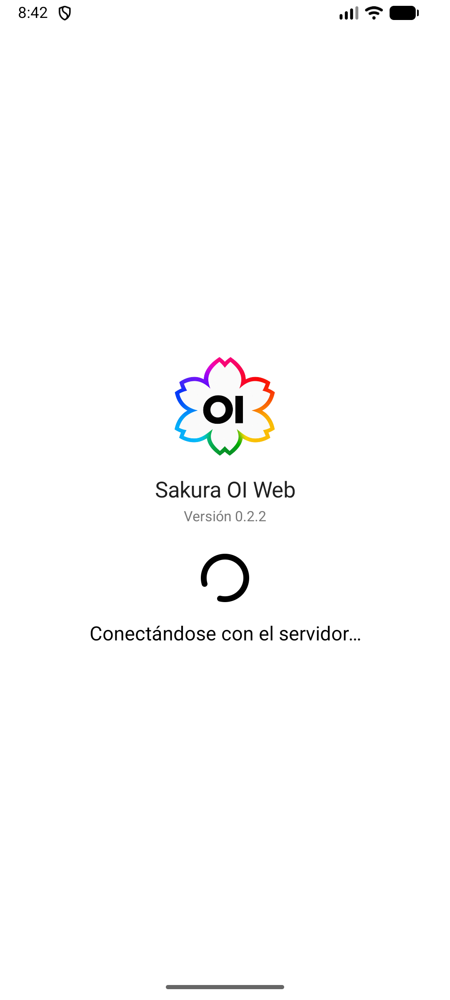

# Implementación Android

## Objetivo: Open WebUI como una app Android

El objetivo general de Sakura OI Web (antes SakuraWebApp) es ofrecer Open WebUI como una aplicación Android completa y cómoda de usar, manteniendo la página dentro de un WebView propio en vez de abrirla como una pestaña de Chrome. Así, mientras Android mantenga vivo el proceso de la app, al volver a la app se conserva la página ya abierta y no se depende del ciclo de vida de una pestaña del navegador. Chrome puede descartar pestañas en segundo plano para liberar memoria y recargarlas al regresar.

La app habilita cookies y DOM storage, y guarda/restaura el estado de navegación cuando Android recrea la actividad. Esto ayuda a conservar el inicio de sesión y continuar la navegación. No significa que la página quede permanentemente en RAM: Android puede cerrar cualquier app en segundo plano si necesita recursos. Si eso ocurre, Sakura OI Web vuelve a cargar Open WebUI; la sesión web y los datos del servidor son independientes de que la página siga cargada.

Sakura OI Web es la capa Android y Open WebUI sigue siendo el servidor que contiene la interfaz, cuenta, chats y configuración. La app no copia ni sustituye el perfil del servidor. Al iniciar una actividad nueva, abre la página principal configurada. La pantalla de carga muestra el logo, el nombre, la versión y una animación durante al menos tres segundos; una conexión fallida pasa a un mensaje de error después de cinco segundos y ofrece reintentar.

## Compilar la app Android

Esta tabla distingue la versión de Android que puede instalar la app del SDK usado para compilarla:

| Configuración | Valor del proyecto | Significado |
|---|---:|---|
| Android mínimo (minSdk) | API 23 / Android 6.0 | Versión mínima admitida por el APK |
| Android objetivo (targetSdk) | API 36 / Android 16 | Comportamientos del sistema para los que se configura |
| SDK de compilación (compileSdk) | API 37 / Android 17 | SDK que debe instalarse para compilar; el teléfono no requiere Android 17 |
| Sakura OI Web | 0.2.3 (versionCode 27) | Versión actual del proyecto |
| Android Gradle Plugin | 9.4.1 | Plugin de compilación Android |
| Gradle Wrapper | 9.6.0 | Versión incluida y usada por el proyecto |
| Kotlin | 2.2.10 | Versión configurada del plugin de Kotlin |
| JDK para ejecutar Gradle | 17 | JVM usada por Android Studio/Gradle |
| Compatibilidad del código Java | 11 | Nivel de lenguaje configurado |

Instala Android Studio compatible con **Android Gradle Plugin 9.4.1**, JDK 17 y **Android SDK Platform API 37.0** desde **Tools → SDK Manager → SDK Platforms**. El proyecto declara `compileSdk { version = release(37) }`, que usa la plataforma base API 37.0. No hace falta instalar todas las plataformas de la lista: la entrada API 37.1 que aparece en tu captura es opcional y el proyecto no la fija. No necesitas instalar Gradle por separado; el wrapper usa Gradle 9.6.0. El teléfono Android 16 de referencia corresponde a API 36 y la app también tiene `targetSdk = 36`; Android SDK 37 se necesita en la computadora para compilar, no en el teléfono.

Abre en Android Studio la carpeta raíz del proyecto. En la pestaña **Terminal**, desde esa carpeta, ejecuta:

```powershell
.\gradlew.bat assembleDebug -PSAKURA_WEBUI_URL="https://<IP-o-host-del-PC>:8081/"
```

Reemplaza el marcador por la dirección HTTPS que el teléfono pueda alcanzar y quita los signos `< >`. No publiques una IP privada. La sección siguiente explica qué valores de host deben coincidir.

El APK se genera en `app/build/outputs/apk/debug/` (normalmente `app-debug.apk`). Si Android SDK Platform API 37.0 no aparece instalado, Gradle informará el error; instálalo en SDK Manager y ejecuta de nuevo el comando. API 37.1 y las plataformas API 36, 35 o anteriores no son requisitos de compilación para esta configuración. Si el servidor usa una CA local, sigue primero la guía [HTTPS y certificados](HTTPS.md) y agrega su certificado público al build local.

El comando incluye la URL de tu servidor. Si usas el menú **Build → Build APK(s)** sin configurar esa propiedad, el proyecto conserva el host de ejemplo y el APK no podrá encontrar tu Open WebUI.

Para no escribir la URL en cada compilación, guárdala en el archivo de propiedades de Gradle de tu usuario, `%USERPROFILE%\.gradle\gradle.properties` en Windows. Está fuera del repositorio, así que tu dirección no acaba en Git, y Android Studio la usa también con **Build → Build APK(s)** y el botón **Run**:

```properties
SAKURA_WEBUI_URL=https://<IP-o-host-del-PC>:8081/
```

Referencias oficiales: [compatibilidad de Android Gradle Plugin](https://developer.android.com/build/releases/about-agp), [JDK para builds Android](https://developer.android.com/build/jdks), [Android 16 / API 36](https://developer.android.com/tools/releases/platforms#android_16), [Android 17 / API 37](https://developer.android.com/about/versions/17/release-notes).

## Qué host/IP se configura

Se configura la dirección del equipo Windows donde corre Open WebUI, en HTTPS y puerto 8081; no la dirección del teléfono ni `127.0.0.1`. En la versión local se usaba una IP privada de LAN. El repositorio público la reemplaza por `https://open-webui.example:8081/` para no publicar la dirección doméstica.

Pasa tu host al compilar:

```powershell
.\gradlew.bat assembleDebug -PSAKURA_WEBUI_URL="https://<IP-o-host-del-PC>:8081/"
```

Gradle la incorpora en `BuildConfig.WEBUI_URL`; `MainActivity.kt` la usa para abrir Open WebUI y comprobar el origen del permiso del micrófono. Mantén esa dirección igual en `WEBUI_URL`, `CORS_ALLOW_ORIGIN`, el certificado TLS y el teléfono. Si cambias la dirección del PC, actualiza todos esos valores y vuelve a compilar.

## Ícono y logo de Sakura OI Web

Desde la versión 0.2.1 la app usa la identidad Sakura OI Web: una flor de cinco pétalos con el contorno en arcoíris y las letras **OI** en el centro. El arte original está en `assets/sakura-oi-web-original.png` y la versión recortada y cuadrada en `assets/sakura-oi-web-icon.png`. A partir de esa imagen se generaron:

- `app/src/main/res/drawable-nodpi/sakura_foreground.png`: primer plano del icono adaptable (Android 8 o posterior), con el logo dentro de la zona segura sobre fondo blanco.
- `app/src/main/res/mipmap-*/ic_launcher.webp` e `ic_launcher_round.webp`: iconos para versiones anteriores a Android 8, sobre un cuadrado redondeado y un círculo blancos.
- `app/src/main/res/drawable-nodpi/sakura_logo.png`: el logo que aparece en las pantallas de carga y de error de conexión.

El manifiesto selecciona `@mipmap/ic_launcher` y `@mipmap/ic_launcher_round`. La identidad anterior (la flor rosa) se conserva en `assets/sakura-original.png` y `assets/sakura-icon.png`.

<div align="center">
  
</div>

Para cambiarla desde Android Studio:

1. Clic derecho en `app/src/main/res` → **New → Image Asset**.
2. En **Icon Type**, selecciona **Launcher Icons (Adaptive and Legacy)**.
3. Elige tu PNG como imagen de primer plano y ajusta el recorte/tamaño.
4. Elige un color de fondo, revisa la vista previa y pulsa **Next → Finish**.
5. Revisa que el manifiesto siga apuntando a los recursos `ic_launcher`.

Para una imagen que se muestra en una pantalla, agrega el archivo a `app/src/main/res/drawable-nodpi/` (por ejemplo, `sakura_banner.png`) y cárgalo con `R.drawable.sakura_banner`. Mantén nombres de recursos en minúsculas, números y guion bajo. No uses la carpeta `mipmap` para imágenes normales.

## Micrófono: permiso Android y permiso WebView

Hay dos autorizaciones independientes: Android debe conceder `RECORD_AUDIO` a Sakura OI Web y el WebView debe aprobar la solicitud de origen web.

- `AndroidManifest.xml` declara `INTERNET`, `RECORD_AUDIO`, `MODIFY_AUDIO_SETTINGS` y `POST_NOTIFICATIONS` (este último para las [notificaciones](#notificaciones-de-android)).
- La app solicita `RECORD_AUDIO` en tiempo de ejecución mediante Activity Result API.
- `WebChromeClient.onPermissionRequest` valida que el origen coincide con el host HTTPS configurado y concede solo `RESOURCE_AUDIO_CAPTURE`. Las demás solicitudes se rechazan.
- `onPermissionRequestCanceled` limpia una solicitud pendiente.
- `mediaPlaybackRequiresUserGesture = false` permite que el audio generado por Open WebUI se reproduzca sin una segunda pulsación.
- Los errores TLS se cancelan; la app no acepta certificados inválidos a ciegas.

Concede también el permiso en Android: **Ajustes → Aplicaciones → Sakura OI Web → Permisos → Micrófono**. HTTPS con un certificado confiable es necesario para que el contenido web pueda acceder a dispositivos multimedia en WebView. Las reglas de origen seguro se describen en la [documentación de WebChromeClient](https://developer.android.com/reference/android/webkit/WebChromeClient).

## Selector de archivos e imágenes múltiples

Al tocar “Subir Archivos” en Open WebUI, la app abre el selector de documentos del sistema Android. No depende de un explorador incrustado en la página: la app conecta el WebView con el selector nativo mediante `WebChromeClient.onShowFileChooser`.

La app lanza `ACTION_OPEN_DOCUMENT` con `CATEGORY_OPENABLE`, tipo `*/*` y `EXTRA_ALLOW_MULTIPLE=true`. Al volver, procesa `ClipData` para varios elementos y `Intent.data` para un solo elemento, y entrega todos los URI al callback de la página. Android otorga acceso a los elementos que el usuario eligió, por lo que no se concede permiso general de almacenamiento. La elección del sistema admite seleccionar varias imágenes/archivos en una operación. Es el flujo recomendado de [ACTION_OPEN_DOCUMENT](https://developer.android.com/reference/android/content/Intent#ACTION_OPEN_DOCUMENT).

Para que la página pueda cerrar una vista previa de imagen a pantalla completa, el botón Atrás envía Escape a los diálogos web antes de navegar hacia atrás o cerrar la app.

## Notificaciones de Android

Cuando Sakura termina de responder y la app está en segundo plano, o estás en otro chat, aparece una notificación de Android con el título del chat y el inicio de la respuesta.


Cómo funciona:

- Open WebUI ya avisa con la API de notificaciones del navegador (`new Notification(...)`), pero el WebView de Android no la implementa. `WebNotificationBridge.kt` inyecta un sustituto de `window.Notification` en la página que reenvía cada aviso a la app mediante una interfaz JavaScript, y la app lo publica en el canal **Mensajes de Sakura**.
- El puente solo responde mientras el WebView muestra el origen HTTPS configurado en `SAKURA_WEBUI_URL`.
- Open WebUI guarda el ajuste de notificaciones en el servidor, por usuario. Si ya lo activaste en otro navegador, la página nunca pide permiso en el teléfono, así que la app solicita `POST_NOTIFICATIONS` por su cuenta la primera vez que carga Open WebUI (Android 13 o posterior).
- Al volver a la app se borran los avisos pendientes, porque ya estás viendo Open WebUI.
- Tocar una notificación abre la app donde la dejaste. Open WebUI no indica en el aviso a qué chat corresponde, así que no se abre ese chat directamente.

Para activarlas:

1. Acepta el permiso de notificaciones cuando Android lo pida. Si lo rechazaste, actívalo en **Ajustes → Aplicaciones → Sakura OI Web → Notificaciones**.
2. En Open WebUI, activa **Ajustes → Interfaz → Notificaciones**.

Limitación: los avisos dependen de que Android mantenga viva la app en segundo plano. Si el sistema la cierra para liberar memoria, no hay conexión con el servidor y no llega la notificación. Para avisos garantizados haría falta enviar notificaciones push desde el servidor, que este proyecto no implementa.

Si no aparecen, filtra Logcat por la etiqueta `SakuraWebApp`: el puente registra cuándo descarta un aviso y si fue por el origen o por el permiso.

## Teclado, tamaño y navegación

- El Activity usa `windowSoftInputMode="adjustResize"`.
- Los insets de Android se aplican al WebView y a las pantallas de carga para que el teclado no tape el compositor.
- `settings.textZoom = 120` y `setInitialScale(110)` mantienen el tamaño de lectura ampliado.

## Barras del sistema y tema oscuro

La app dibuja su contenido detrás de la barra de estado (arriba, donde están la hora y las notificaciones) y de la barra de navegación (abajo, donde Android muestra la línea de gestos). Antes de la versión 0.2.1 esas dos franjas eran siempre blancas, así que al cambiar Open WebUI al tema oscuro quedaban dos bandas blancas arriba y abajo.

Ahora `PageThemeBridge.kt` instala en la página un pequeño script que detecta el color de fondo que Open WebUI pinta arriba y abajo de la pantalla y se lo pasa a la app como `window.SakuraTheme`. La app colorea cada franja con ese color y elige iconos claros u oscuros según el contraste. El script vuelve a medir cuando cambia el tema en Open WebUI (**Ajustes → General → Tema**), cuando cambia el modo oscuro del sistema y una vez por segundo, por si la página cambia sin aviso. Solo la página de Open WebUI configurada en `SAKURA_WEBUI_URL` puede cambiar estos colores.

Las pantallas de carga y de error, y la ventana que Android muestra mientras abre la app, siguen el modo claro u oscuro del teléfono.

<div align="center">
  
</div>
- Atrás cierra primero la vista de imagen/diálogo web y luego usa el historial del WebView.

## Carga y error de conexión

Al abrir o reanudar una nueva instancia de Sakura OI Web, primero aparece una pantalla propia de carga con el logo, el nombre y la versión de la app, un indicador giratorio y el texto “Conectándose con el servidor…”, ambos en negro (en blanco si el teléfono está en modo oscuro). No es la pantalla de Open WebUI: es el estado de inicio de la app. Cuando el servidor responde, se oculta la carga y se muestra la interfaz completa de Open WebUI dentro del WebView. Si la página principal no carga en cinco segundos, la app presenta una pantalla propia de error “No hay conexión con Sakura”, en vez de dejar una página blanca o mostrar el error de Chromium. El botón **Reintentar** (negro con la flecha blanca, o blanco con la flecha negra en modo oscuro) vuelve a mostrar la carga y realiza una nueva navegación. Android puede destruir el proceso en segundo plano; al abrir de nuevo, la carga vuelve a mostrarse.

| Al conectar | Si no hay conexión |
|:--:|:--:|
|  |  |

El teléfono tiene que alcanzar el servidor: la IP local no funciona por datos móviles salvo que el servidor esté expuesto de forma segura o haya VPN/ruta. El texto de conexión no inicia el servidor.

## Recursos importantes del código

- `app/src/main/java/com/sakura/webapp/MainActivity.kt`: WebView, carga, archivos, micrófono y navegación.
- `app/src/main/java/com/sakura/webapp/WebNotificationBridge.kt`: notificaciones de Android para los avisos de Open WebUI.
- `app/src/main/java/com/sakura/webapp/PageThemeBridge.kt`: color de las barras del sistema según el tema de Open WebUI.
- `app/src/main/java/com/sakura/webapp/LogoSpinnerView.kt`: indicador giratorio de la pantalla de carga.
- `app/src/main/AndroidManifest.xml`: permisos y Activity.
- `app/src/main/res/xml/network_security_config.xml`: CA aceptadas.
- `app/build.gradle.kts`: versiones Android y URL de build.
